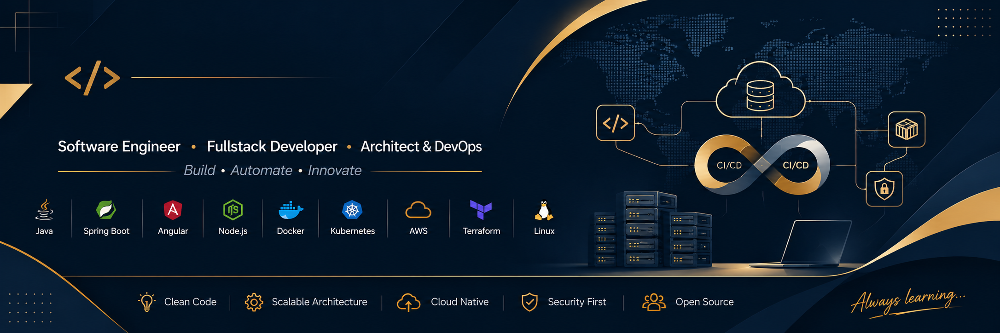
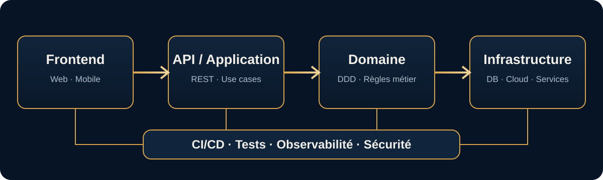

# Badara Ba
### Software Engineer · Fullstack Developer · Architecture & DevOps

**Design. Build. Automate. Evolve.**

[Français](README.md) · [English](README.en.md) · [Español](README.es.md)

---

## About

I'm **Badara Ba**, a Fullstack Developer interested in maintainable software, robust architecture and deployment automation.

I enjoy understanding problems, shaping sound solutions, writing readable code, testing components and building reliable delivery pipelines. My main areas of interest are software architecture, backend engineering, cloud and DevOps practices.

- **Backend:** Java, Spring Boot, Node.js, Express, PHP
- **Frontend & mobile:** JavaScript, TypeScript, Angular, HTML5, Flutter
- **Architecture:** Hexagonal Architecture, DDD, SOLID, Clean Code, REST APIs
- **DevOps & Cloud:** Docker, Kubernetes, Terraform, Ansible, AWS, CI/CD
- **Quality & observability:** GitHub Actions, SonarQube, Prometheus, Grafana, OpenTelemetry

## Technology stack

**Languages**

**Backend & frameworks**

**DevOps, Cloud & quality**

## Architecture principles

I aim for clear separation of concerns: the interface communicates with application use cases, the domain owns business rules, and infrastructure implements technical details.

Topics I explore and apply in my projects:

- Hexagonal Architecture and domain / infrastructure separation
- Domain-Driven Design (DDD) and API design
- SOLID, Clean Code, automated testing and TDD
- Containers, orchestration and Infrastructure as Code
- CI/CD, observability and software supply-chain security

## Selected projects

| Project | Description | Technologies |
|---|---|---|
| [todo-infra](https://github.com/bbabadara/todo-infra) | AWS infrastructure automation, provisioning, configuration, monitoring and security | Terraform, Ansible, AWS, Prometheus, Grafana, Loki, Tempo, CrowdSec |
| [todo-back](https://github.com/bbabadara/todo-back) | Backend API with instrumentation and container-registry deployment | Express, Supabase, OpenTelemetry, GHCR |
| [todo-front](https://github.com/bbabadara/todo-front) | Containerized single-page application served through Nginx | JavaScript, Nginx, GHCR |
| [wallet-hexagonal-m1-e221](https://github.com/bbabadara/wallet-hexagonal-m1-e221) | Practical implementation of Hexagonal Architecture in Java | Java, Hexagonal Architecture |
| [sunuagri](https://github.com/bbabadara/sunuagri) | Java application focused on agricultural management | Java |
| [masterclass-fondamentaux-programmation-python](https://github.com/bbabadara/masterclass-fondamentaux-programmation-python) | Learning resources for Python programming fundamentals | Python, education |

## GitHub activity

### Contribution Snake

---

### Contact

**Build with care. Engineer with purpose. Keep learning.**

