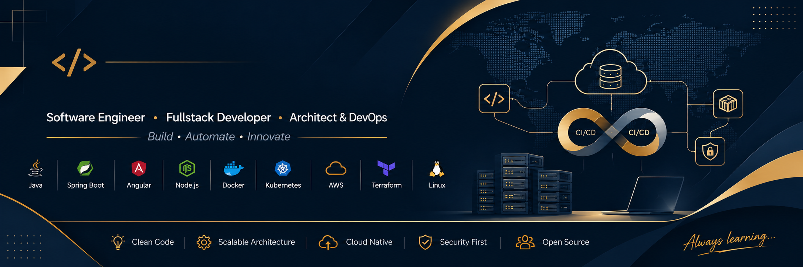
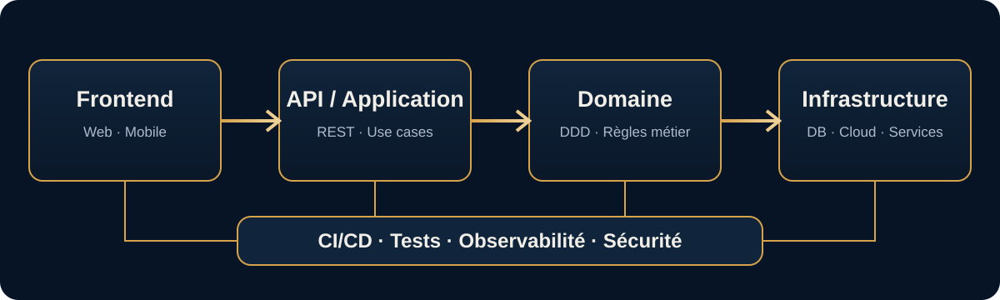

# Badara Ba
### Ingeniero de Software · Desarrollador Fullstack · Arquitectura & DevOps

**Diseñar. Desarrollar. Automatizar. Evolucionar.**

[Français](README.md) · [English](README.en.md) · [Español](README.es.md)

---

## Perfil

Soy **Badara Ba**, desarrollador Fullstack interesado en el software mantenible, las arquitecturas sólidas y la automatización de despliegues.

Me gusta comprender los problemas, diseñar soluciones bien estructuradas, escribir código legible, probar los componentes y construir procesos de entrega fiables. Mis principales áreas de interés son la arquitectura de software, el desarrollo Backend, la nube y las prácticas DevOps.

- **Backend:** Java, Spring Boot, Node.js, Express, PHP
- **Frontend y móvil:** JavaScript, TypeScript, Angular, HTML5, Flutter
- **Arquitectura:** Arquitectura hexagonal, DDD, SOLID, Clean Code, API REST
- **DevOps y Cloud:** Docker, Kubernetes, Terraform, Ansible, AWS, CI/CD
- **Calidad y observabilidad:** GitHub Actions, SonarQube, Prometheus, Grafana, OpenTelemetry

## Stack tecnológico

**Lenguajes**

**Backend y frameworks**

**DevOps, Cloud y calidad**

## Principios de arquitectura

Busco una separación clara de responsabilidades: la interfaz se comunica con los casos de uso, el dominio contiene las reglas de negocio y la infraestructura implementa los detalles técnicos.

Temas que exploro y aplico en mis proyectos:

- Arquitectura hexagonal y separación entre dominio e infraestructura
- Domain-Driven Design (DDD) y diseño de API
- SOLID, Clean Code, pruebas automatizadas y TDD
- Contenedores, orquestación e Infrastructure as Code
- CI/CD, observabilidad y seguridad de la cadena de suministro de software

## Proyectos destacados

| Proyecto | Descripción | Tecnologías |
|---|---|---|
| [todo-infra](https://github.com/bbabadara/todo-infra) | Infraestructura AWS y automatización: aprovisionamiento, configuración, monitorización y seguridad | Terraform, Ansible, AWS, Prometheus, Grafana, Loki, Tempo, CrowdSec |
| [todo-back](https://github.com/bbabadara/todo-back) | API backend con instrumentación y despliegue mediante un registro de contenedores | Express, Supabase, OpenTelemetry, GHCR |
| [todo-front](https://github.com/bbabadara/todo-front) | Aplicación SPA contenerizada y servida mediante Nginx | JavaScript, Nginx, GHCR |
| [wallet-hexagonal-m1-e221](https://github.com/bbabadara/wallet-hexagonal-m1-e221) | Implementación práctica de arquitectura hexagonal en Java | Java, arquitectura hexagonal |
| [sunuagri](https://github.com/bbabadara/sunuagri) | Aplicación Java orientada a la gestión agrícola | Java |
| [masterclass-fondamentaux-programmation-python](https://github.com/bbabadara/masterclass-fondamentaux-programmation-python) | Recursos pedagógicos para aprender los fundamentos de Python | Python, educación |

## Actividad en GitHub

### Contribution Snake

---

### Contacto

**Construir con rigor. Diseñar con propósito. Aprender siempre.**

